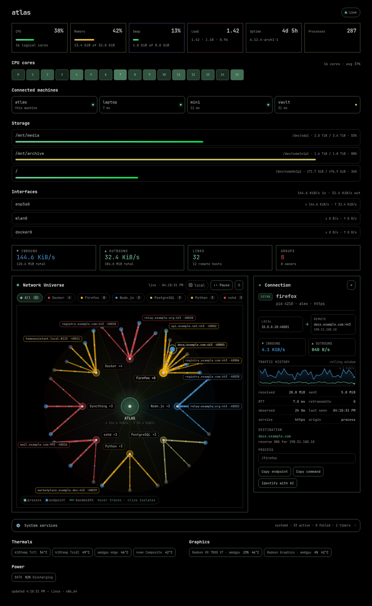
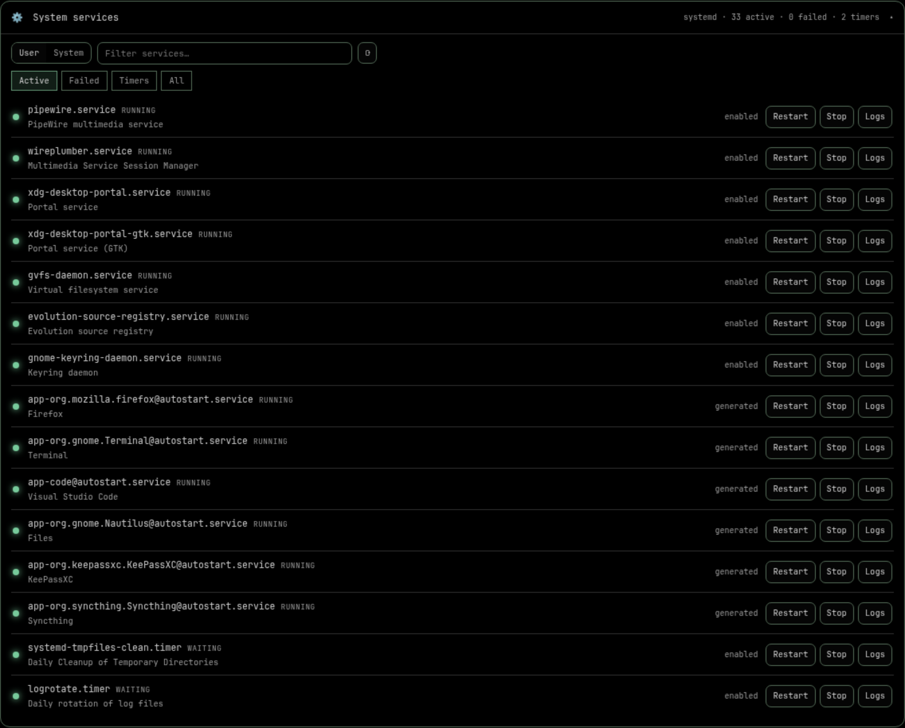

  

<h1 align="center">System</h1>

  <a href="https://orqella.io">Website</a> ·
  <a href="https://github.com/orqella/orqella#install">Quick start</a> ·
  <a href="https://github.com/orqella/orqella#modules">Modules</a> ·
  <a href="https://github.com/orqella/orqella#desktop-client">Desktop client</a> ·
  <a href="https://orqella.io/docs/">Documentation</a>

Live host metrics plus two cross-platform diagnostics backed by a sidecar:

- **Network Universe** — live TCP/UDP sockets enriched with process and remote
  endpoint data (TCP on Windows).
- **System services** — a searchable service browser with platform-native
  actions where they are safe.

The core CPU, memory, storage, thermal, GPU, battery, and network-interface
views use the host `system.metrics` API. The sidecar is used only for the
network and service probes. If the sidecar cannot start, those two sections
stay hidden and the metric views continue to work.

## Platform support

| Platform | Network Universe | Services |
| --- | --- | --- |
| Linux | `ss` with per-socket byte counters, Docker cgroups, and systemd attribution | systemd user/system units, user actions, journal logs, timers |
| macOS | `netstat -v` with process attribution; no per-socket counters | user-installed launchd jobs; restart action; no log viewer |
| Windows | `Get-NetTCPConnection` via PowerShell with process attribution; no per-socket counters | Windows services with start/stop/restart where permitted; no log viewer |

Network rates and traffic history are only available on Linux because it is the
only platform here that exposes per-socket byte counters without eBPF or ETW.
macOS and Windows still show live connections, ownership, endpoints, DNS, and
service names.

## AI identification

Inspecting a connection exposes **Identify with AI**. This requires the module's
sensitive `agent` permission and a configured Orqella agent (OpenCode by default).
The sidecar creates a temporary workspace containing only the selected
connection, and the agent is asked to do bounded, read-only investigation — DNS,
RDAP/WHOIS, ASN, TLS certificates, service banners, and local process context —
then write `FINDINGS.md`. The inspector renders that report as Markdown and keeps
the raw agent log collapsed. Completed reports are kept per connection identity —
same protocol, remote endpoint, and owner — so selecting that connection again
shows the saved report; **Run again** starts a fresh investigation. No private
key material or unrelated system data is included.

The agent runs outside the sidecar sandbox by design. Grant only if you trust the
configured agent; the prompt tells it to treat every connection field as
untrusted data and restricts changes to the temporary workspace. Investigation
records live under `data/identify/` (0700, files 0600), not in the module
checkout, so an investigation never blocks a module update.

Service actions return HTTP 200 with `ok: false` when the service manager
rejects a start/stop/restart; the UI shows the manager's `detail` text. The
request itself is valid, so callers should inspect the body rather than relying
on the HTTP status alone.

On macOS, Apple launchd agents and GUI application jobs are filtered out so the
list stays focused on user-installed services. System-domain launchd inspection
requires root and is not attempted.

## Requirements

The sidecar runs unsandboxed because it needs native OS inspection tools and
service-control utilities. It requires:

- Python 3.9+ as `python3`, `python`, or the Windows `py -3` launcher on `PATH`
- Linux: `ss` and `systemctl`; `journalctl` for logs
- macOS: `netstat`, `ps`, and `launchctl`
- Windows: PowerShell with `Get-NetTCPConnection` and `Get-Service`
- A configured Orqella agent for **Identify with AI** (OpenCode by default)

The sidecar declares all three platforms. If Python is missing, the module still
installs and its metric views work, but Network Universe and System services are
hidden.

A fresh install auto-grants `backend`; an update to an existing install lists it
under pending permissions until reviewed.
